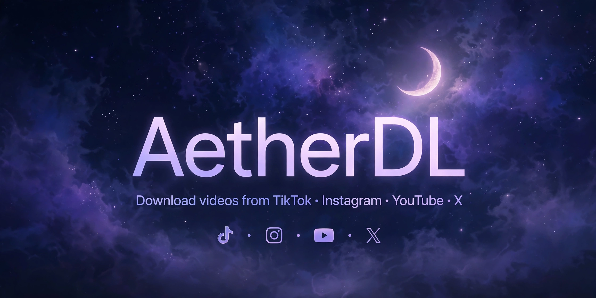

# AetherDL


Bot Discord untuk download video dari TikTok, Instagram, YouTube, X, Facebook, dan lainnya. Paste link di chat atau pakai slash command — video langsung dikirim ke Discord.

## Fitur

- **Auto-detect**: paste link media di chat, bot otomatis proses dan kirim hasilnya.
- **Resolusi asli**: video diambil dalam resolusi aslinya.
- **File langsung**: video ≤ 25MB dikirim sebagai file (bisa di-play inline di Discord); di atas itu dikirim sebagai tombol link download.
- **Video HD**: hasil merge resolusi pilihan di atas 25MB di-upload ke file hosting dan dikirim link HD-nya.
- **Privasi**: pesan link kamu dihapus setelah hasil terkirim, jadi tidak kelihatan siapa yang minta.

## Command

| Command | Fungsi |
|---|---|
| `/use <link>` | Download video (opsional: pilih `resolusi` 360p / 480p / 720p / 1080p) |
| `/usemp4 <link>` | Download video sebagai MP4 (opsional: `resolusi`) |
| `/usemp3 <link>` | Download audio sebagai MP3 |

Platform: TikTok, Instagram, YouTube, X/Twitter, Facebook, Reddit, Pinterest.

## Jalankan sendiri

```bash
npm install
# isi TOKEN bot Discord di .env
node Index.js
```

Butuh Node.js, `ffmpeg`, dan `yt-dlp`. Token bot Discord **jangan** di-commit — pakai file `.env` (sudah di-`.gitignore`).
